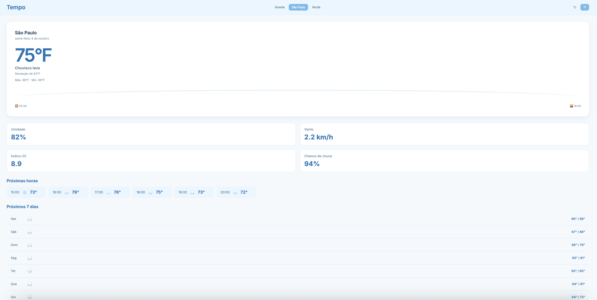

# Tempo

App de previsão do tempo feito com React e Vite. Mostra o clima atual, a previsão das próximas horas e dos próximos 7 dias para Brasília, São Paulo e Recife, com troca entre °C e °F.

🔗 **Veja o app funcionando:** [appclima-navy.vercel.app](https://appclima-navy.vercel.app)



## Funcionalidades

- Clima atual com temperatura, sensação térmica, máxima e mínima
- Troca entre °C e °F
- Umidade, vento, índice UV e chance de chuva
- Previsão das próximas 6 horas
- Previsão dos próximos 7 dias
- Nascer e pôr do sol de cada cidade
- Ilustração que muda conforme o clima (ensolarado, nublado, chuva ou neve)
- Escolha entre Brasília, São Paulo e Recife
- Lembra a cidade e a unidade escolhidas
- Mensagem de erro com botão "Tentar novamente"
- Layout responsivo, que se adapta a celular, tablet e computador

## Tecnologias

- React
- Vite
- JavaScript
- CSS
- [Open-Meteo API](https://open-meteo.com/) para os dados do clima
- Vercel para a publicação

## Como rodar o projeto

1. Clone o repositório:

```bash
git clone https://github.com/isahlbbh/appclima.git
```

2. Entre na pasta e instale as dependências:

```bash
cd appclima
npm install
```

3. Rode o projeto:

```bash
npm run dev
```

4. Abra no navegador o endereço que aparecer no terminal (normalmente `http://localhost:5173`).

## O que aprendi

- Passar dados entre componentes com props e guardar informações com `useState`
- Buscar dados de uma API com `fetch` e `useEffect`
- Converter unidades (°C para °F) em uma função reaproveitável, separada dos componentes
- Mostrar conteúdo diferente conforme a situação (carregando, erro ou dados prontos)
- Tratar erros de rede e oferecer um botão para tentar de novo
- Guardar preferências do usuário com `localStorage`
- Organizar o projeto em pastas (`components`, `services`, `utils`, `styles`)
- Usar Git e GitHub e publicar um app na Vercel
- Tornar o layout responsivo com media queries, aplicando ajustes só em telas pequenas
- Usar `flex-wrap` para os itens descerem de linha quando falta espaço, em vez de vazarem da tela
- Evitar que itens de uma lista com rolagem horizontal sejam espremidos, usando `flex-shrink: 0` e `overflow-x: auto`
- Testar o layout em celular e tablet com o modo de dispositivos do DevTools
- Agrupar muitos códigos da API em poucas categorias com uma função separada (`getWeatherGroup`)
- Importar imagens no Vite e escolher a imagem certa com uma tabela de consulta (objeto)
- Mostrar uma imagem só quando os dados já chegaram, com renderização condicional (`&&`)
- Controlar o formato de uma imagem com `aspect-ratio` e `object-fit`
- Recuperar um projeto com `git clone` e `npm install` depois de perder os arquivos locais

## Melhorias futuras

- Buscar qualquer cidade pelo nome, em vez de só três cidades fixas
- Detectar a localização do usuário para mostrar o clima de onde ele está
- Mostrar a previsão por hora de qualquer dia, e não só das próximas 6 horas
- Adicionar um tema escuro
- Criar testes automatizados para as funções de conversão

## Autora

Feito por **Isabelly Melo**.

- GitHub: [@isahlbbh](https://github.com/isahlbbh)
